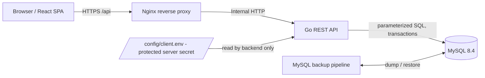
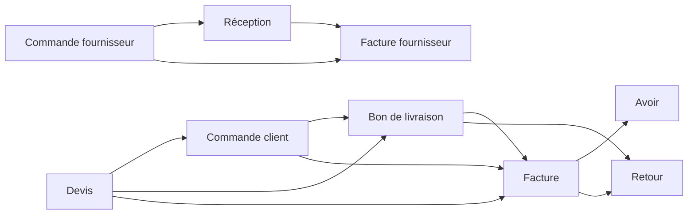

# Architecture — Vostrogate 1.0.0

## System boundaries

One codebase, **one company per deployed database**. This is **not** a SaaS multitenant architecture. Multiple clients are deployed as separate Docker stacks/configurations/databases. The browser never selects a tenant or sees the backend DB password.

## Data boundaries

- `company` row ID 1: legal/trade name, fiscal identifiers, currency and the **binary company logo**.
- `settings`: JSON values such as document prefixes. This is in MySQL and included in dumps.
- `users`, `roles`, `permissions`, `role_permissions`, `sessions`: authentication/authorization state. Sessions are hashed, expire, and are not stored in `localStorage`.
- `products`, `reference_values`, `parties`: master data. Product barcode is unique where present.
- `warehouses`, `stock_balances`, `stock_movements`, `stock_adjustments`: quantity in milliunits; movements have unique idempotence keys.
- `documents`, `document_lines`, `document_sequences`: trade documents, snapshot descriptions/prices, statuses, conversion lineage and automatic numbering.
- `payments`: settled vs pending cheques; `expenses`, `audit_log` for financial/admin activity.
- Browser `localStorage`: **unsaved draft only** (`vg:draft:u{userId}-...`); safe to clear without losing official records.

## Business-state rules

### Document workflow

Documents start **DRAFT** and transition to **FINAL** or **CANCELLED**. Finalizing DELIVERY / PURCHASE_RECEIPT / RETURN or a direct INVOICE / PURCHASE_INVOICE can post stock movements (according to source document ancestry); conversion uses source link and unique conversion key to prevent duplicate stock movements. Cancellation may reverse effects subject to transaction constraints.

Money is stored in **centimes integer**; quantities in **milliunit integer**. Line-level tax and discount calculations are performed again by Go; values from the browser are not trusted. Document line prices are snapshots, so later article price edits do not rewrite past invoices.

### Settlement

- Cash/card/bank transfer: cleared immediately, increases `paid_cents`.
- Cheque/effect: begins **PENDING**; only clearing increases paid amount. Rejection marks it rejected and frees pending balance.
- New payments cannot exceed available document balance after considering outstanding pending cheques.
- Uninvoiced finalized BL may be paid. When converted, existing payments are transferred to the invoice, avoiding double counting.

### Stock

- Initial stock is a recorded positive movement.
- Adjustments write stock quantity and a ledger entry in one transaction.
- Negative stock is rejected by default.
- POS saves a finalized invoice, payment and inventory movements in the same MySQL transaction.

## Permission model

RBAC is server enforced. Every relevant REST route requires one of `dashboard.read`, `customers.read/write`, `suppliers.read/write`, `products.read/write`, `catalog.manage`, `sales.read/write/finalize/convert/cancel`, `purchases.*`, `inventory.read/adjust`, `payments.read/create/clear`, `cheques.read/manage`, `expenses.read/write`, `reports.read/export`, `pos.use`, `settings.read/manage`, `users.read/manage`, `roles.manage`, `audit.read`.

Seed roles: ADMIN, SALES, CASHIER, ACCOUNTANT, STOCK, MANAGER. `is_owner_admin=true` is reserved for the initial installation user; the initial admin always has full permissions, even if other roles are later customized.

## Search performance

Products API: `GET /api/products/search?q=...`, top 20, only active products. Exact barcode or SKU ranks first, then prefix/contains matches; MySQL has indexes on SKU and name and unique barcode. For >100k articles, evaluate a dedicated fulltext/tokenized search and benchmark on production-sized data.

## Backend extension points

`backend/internal/app/{products,parties,documents,payments,stock,pos,users,reports,company}.go` contain distinct domain endpoints. `backend/internal/db/migrations/` holds SQL migrations. New endpoints require server-side role checks, input validation, transactions for writes, audit events and frontend role-aware navigation.

## Important deployment issue

The app config uses **environment secrets stored in a file outside MySQL** because the database cannot hold the credentials needed to connect to itself. Therefore a *database backup plus protected config secrets* is the minimum complete disaster recovery set. Other business configuration and binary logo are in MySQL.
